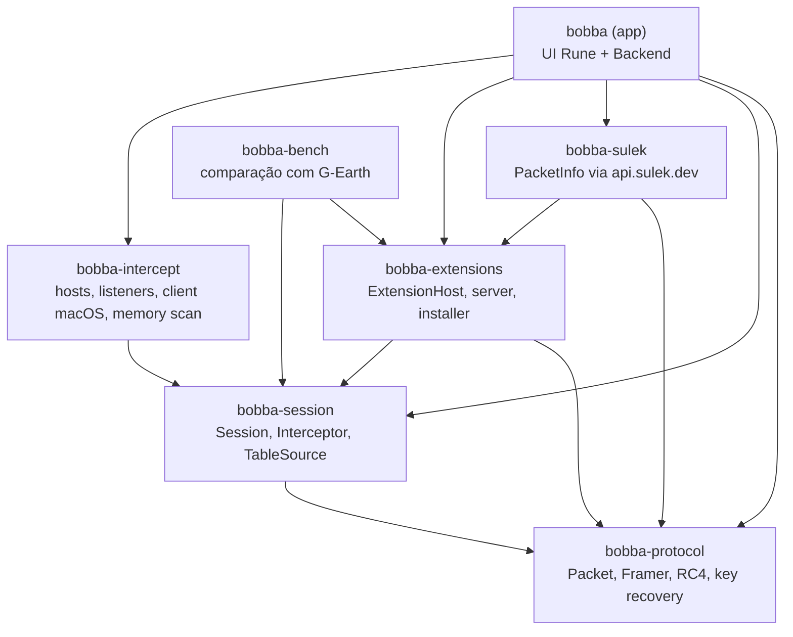
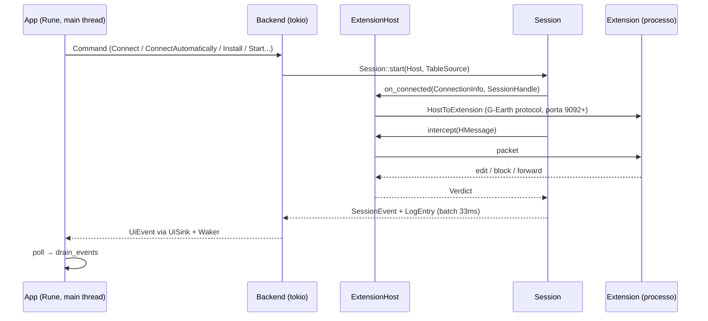

# Arquitetura do Bobba

Bobba é um proxy MITM para o Habbo: fica entre o client e o hotel, decifra o tráfego RC4, mostra os packets e deixa extensions (compatíveis com G-Earth) ler, editar, bloquear e injetar mensagens.

## Crates



Camadas de baixo para cima: `protocol` (bytes puros, sem I/O) → `session` (proxy TCP async) → `extensions` / `intercept` / `sulek` (políticas e integrações) → `app` (UI e orquestração).

```text
crates/
├── protocol/     # wire format: Packet, Framer, Rc4, HMessage, Expression, key_recovery, table_scan, prediction
├── session/      # proxy de uma conexão: readers/writers, decrypt, Interceptor trait, LogEntry
├── extensions/   # ExtensionHost (implementa Interceptor), TCP server G-Earth, installer de .jar/binários
├── intercept/    # modo automático: resolve hotéis, /etc/hosts redirect, HotelListeners, prepara o client, memory (scan da memória do Habbo por OS)
├── sulek/        # PacketInfoLoader que busca e faz cache dos headers por hotel_version
├── app/          # binário `bobba`: Backend (tokio) + estado e views em Rune
└── bench/        # binários de benchmark contra G-Earth 1.5.4
```

## Seams principais

Três traits separam o proxy das políticas:

| Trait | Dono | Implementações | Papel |
|---|---|---|---|
| `Interceptor` | `session` | `PassThrough`, `ExtensionHost` | decide `Verdict::{Forward, Edited, Blocked}` por mensagem |
| `TableSource` | `session` | `NoTables`, `DumpFile`, `MemoryScan` (`intercept`) | fornece as S-boxes RC4 candidatas para recuperar a key, ou `TablesUnavailable` com o motivo |
| `PacketInfoLoader` | `extensions` | `Sulek` | carrega nomes/structures dos headers para a `hotel_version` |

## Session: uma conexão

```text
Session::start(interceptor, tables, events, log)
  Reader(ToServer)  client_read  → decrypt → interceptor.intercept → outgoing_tx
  Reader(ToClient)  server_read  → decrypt → interceptor.intercept → incoming_tx
  write_loop(ToServer)  outgoing_rx + to_server_rx (injeções) → server_write
  write_loop(ToClient)  incoming_rx + to_client_rx (injeções) → client_write
  supervisor
    primeira task que termina ou cancel → shutdown de todas
    interceptor.on_disconnected()  (se a conexão foi confirmada)
    SessionEvent::Ended
```

- O `Reader` lê o version packet (hotel_version, client), e depois de algumas leituras cifradas usa `key_recovery` + `TableSource` para achar o estado RC4 (com probation de 2s).
- `MemoryScan` lê as regions read+write do processo do Habbo em chunks de 16 MiB e roda `table_scan` (256 slots `u32` distintos < 256, sem rotações da identidade). Cada OS tem um adapter em `intercept/src/memory/`: `macos.rs` (`task_for_pid`, exige o Habbo re-assinado com `get-task-allow`) e `windows.rs` (`OpenProcess` + `ReadProcessMemory`).
- Writes são batched (64 KiB) e a fila reader→writer é bounded (`PENDING_WRITES_LIMIT = 4096`).
- `SessionHandle` é o lado externo: injeção nos dois sentidos e cancel.

## App: UI ↔ Backend



- `Backend::spawn(UiSink)` roda o runtime tokio; a UI só manda `Command` e recebe `UiEvent` por `std::sync::mpsc`, acordando o loop do Rune com `Waker`.
- `App` (`state.rs`) é o estado único da UI; `view/*` são funções de render por tela; `scenes.rs` monta estados fake para testes de UI headless.
- O logger de packets abre numa janela própria (`logger.rs`) alimentada por `LogFeed`.

## Modos de conexão

```text
Direct (DirectTarget, via args ou UI)
  TcpListener local → DirectProxy → Session com DumpFile | NoTables

Automático (connect_automatically)
  Prepare   client::client_state  (re-sign do Habbo AIR no macOS se precisar)
  Allow     resolve_hotels → HostsRedirect::apply  (pede admin, edita /etc/hosts)
            HotelListeners::bind em loopbacks dedicados
  Wait      accept_first → remove redirect
  Run       run_session com MemoryScan como TableSource
```

`AutomaticStep` reporta cada etapa para a tela de setup (`view/setup.rs`).
