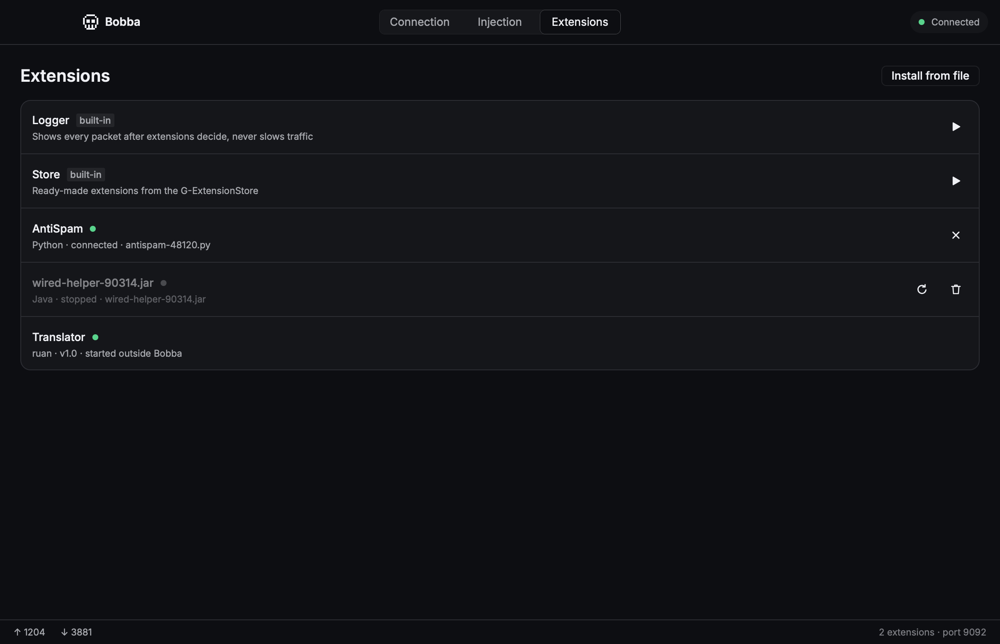
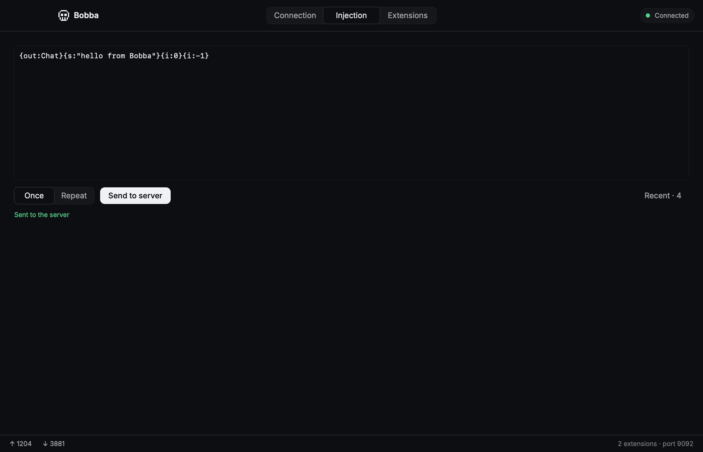

# Bobba

Run your G-Earth extensions on Habbo with an app that's light on your computer.

Bobba sits between Habbo and the hotel, shows you every packet, and runs the same extensions you already use with G-Earth. It's written in Rust and runs natively, with no Java needed to run the app itself.

https://github.com/user-attachments/assets/30b3ea8c-fc9e-4a7d-8f28-218070d6e65d

**[Download the latest version](https://github.com/ruangustavo/bobba/releases/latest)** · macOS and Windows · Flash/AIR client



## Why Bobba

G-Earth is the tool the Habbo community built, and it works. Bobba isn't meant to replace it. It's an alternative that's lighter on your computer and simpler to set up, and as a player you keep using the extensions you already use in G-Earth.

It's lighter: in a busy room Bobba uses about a third of the memory and a sixth of the processor G-Earth uses, which leaves more of your computer for Habbo. It sets itself up: open Bobba, open Habbo, and it connects on its own.

## Works with your G-Earth extensions

Every G-Earth extension runs on Bobba unchanged:

- `.jar` extensions (Java) and G-Python scripts, plus extensions written in Node.js, .NET or Rust
- The Extension Store: browse, install and update the same ready-made extensions, right inside Bobba
- Your G-Earth folder: Bobba finds the extensions you installed there and offers to bring them over

If an extension needs Java or Python and you don't have it, Bobba tells you which one to install and links to the download.

## Lighter on your computer

Both apps running the real Habbo client in the same busy room, measured one after the other:

| In a busy room, packet logger open | G-Earth | Bobba |
|---|---|---|
| Memory (RAM) | 628 MB | 209 MB |
| Processor (CPU), average | 6.0% | 1.0% |
| Memory with one extension running | 652 MB | 184 MB |
| Processor with one extension running | 6.5% | 0.9% |
| Space on disk | 289 MB | 71 MB |

Measured on November 24, 2026 on a Mac (Apple M5 Pro), G-Earth 1.5.4-beta-29 against Bobba 0.1.0, one run of about five minutes per row. The extension's own process isn't counted, since it's the same in both. Not measured on Windows yet.

## Install

### macOS

1. Download `Bobba-<version>-macos.dmg` from the [releases page](https://github.com/ruangustavo/bobba/releases/latest) and drag Bobba to Applications.
2. The first time, right-click Bobba and choose **Open**. macOS warns about apps from outside the App Store; Bobba isn't notarized by Apple yet.
3. Bobba re-signs Habbo once so it can read Habbo's encryption key, and asks for your Mac password each time it connects, to point Habbo at itself for a moment.

### Windows

1. Download `Bobba-<version>-windows.zip` from the [releases page](https://github.com/ruangustavo/bobba/releases/latest) and extract it.
2. Open `Bobba.exe`. If Windows SmartScreen appears, click **More info** and then **Run anyway**; Bobba isn't code-signed yet.
3. Bobba asks for administrator permission each time it connects, to point Habbo at itself for a moment.

## Getting started

1. Open Bobba.
2. Open Habbo from the Habbo Launcher, as usual.
3. Bobba connects on its own. Open the **Logger** to see the packets, the **Injection** tab to send your own, or the **Store** to add extensions.



## For the nerds

Measured with `bobba-bench` against G-Earth 1.5.4-beta-29 on the same inputs. The full method and the commands to reproduce are in [`bench/RESULTS.md`](bench/RESULTS.md).

| | G-Earth | Bobba |
|---|---|---|
| Proxy throughput (packet flood) | 150k to 290k packets/s | 2.1M to 2.3M packets/s |
| Round trip, p50 / p99 | 38 µs / 52 to 56 µs | 40 µs / 59 to 65 µs |
| Memory after three runs (proxy only) | 86 MB | 16.6 MB |
| RC4 key recovery, key present | 2.5 ms | 1.0 ms |
| RC4 key recovery, no key | 450 ms | 0.44 ms |
| Wrong key picked, out of 1,000 logins | 23 | 0 |
| Parse an expression | 2.5 µs | 0.45 µs |
| Predict a structure and format it | 1.4 µs | 0.62 µs |

Bobba adds about 2.5 µs to each round trip because each packet hops from a reader task to a writer task; in exchange it moves 7 to 14 times more packets per second. When more than one scraped RC4 state decrypts the login, Bobba keeps every candidate on probation for the next packet instead of taking the first match, which is why it never settles on the wrong key.

How it fits together:

- `protocol`: wire format, RC4, key recovery, expressions and structure prediction, no I/O
- `session`: the async proxy for one connection
- `extensions`: the G-Earth extension host and server, and the installers
- `intercept`: automatic mode, the hosts redirect and the memory scan on each OS
- `sulek`: packet names and structures per hotel version, from [Sulek](https://sulek.dev/) and the installed client
- `store`: the Extension Store catalog
- `app`: the UI, built with [Rune](https://github.com/anomalyco/rune)

### Build from source

```sh
cargo run --release -p bobba
./scripts/package-macos.sh          # universal Bobba.app and a dmg in target/dist
```

Enable the pre-commit checks once per clone with `git config core.hooksPath .githooks`.

## Contributing

`main` only takes pull requests, and every PR runs the checks on macOS and Windows. Name the PR in [Conventional Commits](https://www.conventionalcommits.org/) form (`feat: …`, `fix: …`), because its title becomes the commit on `main` and the changelog entry. New versions come out of the release PR that release-please keeps open.

## Credits

Bobba builds on work the Habbo community shared:

- [G-Earth](https://github.com/G-Realm/G-Earth), by [sirjonasxx](https://github.com/sirjonasxx) and [UnfamiliarLegacy](https://github.com/UnfamiliarLegacy), who keep its latest fork alive. It's the reference for the extension protocol and packet expressions, and the reason there are extensions to run at all.
- G-MemZ, by [UnfamiliarLegacy](https://github.com/UnfamiliarLegacy). Bobba's reading of Habbo's encryption key from memory is a port of it.
- [G-Rust](https://github.com/G-Realm/G-Rust), by [WiredSpast](https://github.com/WiredSpast): earlier work on G-Earth's types in Rust, and one of the extension frameworks Bobba stays compatible with.
- [Sulek](https://sulek.dev/), for the packet names of every hotel version.

Bobba isn't affiliated with or endorsed by Sulake. Third-party tools may break Habbo's terms of service; use them at your own risk.

## License

[MIT](LICENSE)
